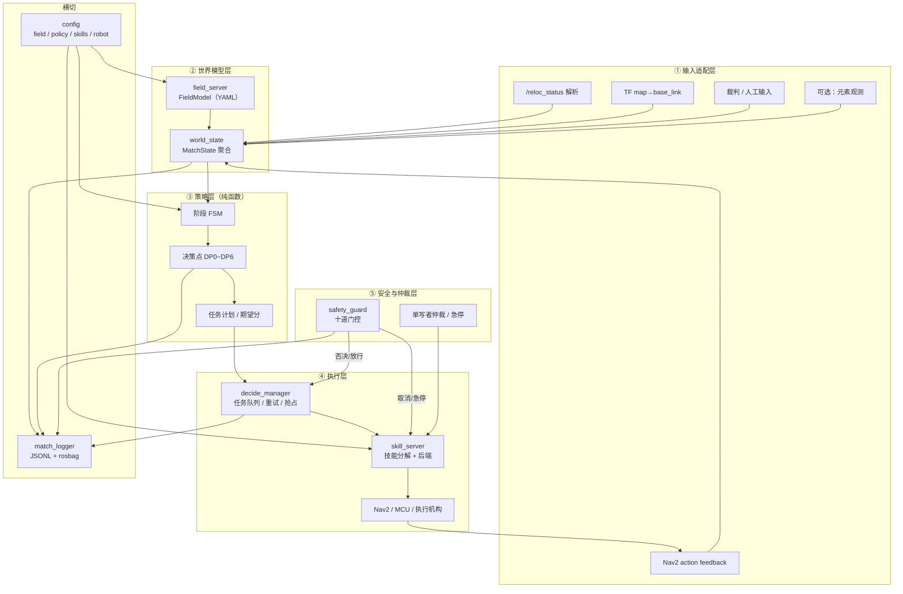
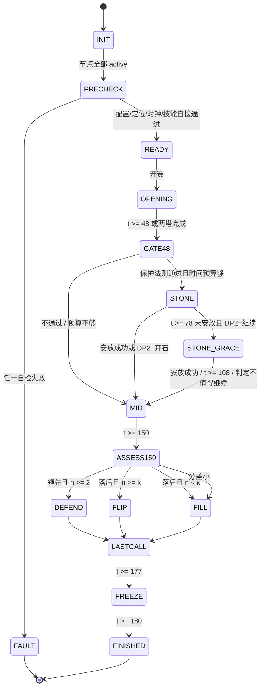

# 01 · 决策层框架设计

> 状态：设计稿（v0.1，2026-10-31）　｜　配套：[02-接口契约](02-接口契约.md)
> 目标：给出一个**能直接照着写代码**的骨架，而不是泛泛的分层图。

---

## 1. 设计目标与硬约束

### 1.1 目标

| # | 目标 | 可验证的度量 |
| --- | --- | --- |
| G1 | 同一套决策代码跑仿真和真机 | 只允许 `use_sim_time`、时钟源、技能后端、输入源不同 |
| G2 | 决策可解释、可回放 | 每次决策输出输入快照 + 规则 ID + 候选得分；离线回放结果一致 |
| G3 | 时间纪律 | 177 s 后不再启动长动作；179 s 前所有技能退出；超时零漏报 |
| G4 | 安全默认拒绝 | 未定位、时钟无效、配置不匹配、技能不可用时**不发目标** |
| G5 | 策略与代码解耦 | 阶段边界、分值、时长、阈值全在 YAML；规则改版不改代码 |
| G6 | 失败可降级 | 任一输入丢失都能退到"停住 + 等人工"，不进入不可控状态 |

### 1.2 来自现有栈的硬约束

这些是设计的前提，不是"以后再说"：

| 约束 | 证据 | 对设计的直接影响 |
| --- | --- | --- |
| `/reloc_status` 是 **2 Hz 的 String**，没有结构化字段 | `Nav/real/scripts/reloc_bridge.py` 的 `publish_status()` | 决策层必须容错解析；建议后续追加 `key=value`，不要另起话题 |
| 未首次定位时 `reloc_bridge` 会发 **identity `map→odom`** | 同上，`bootstrap_tf=True` | **绝不能"有 TF 就认为已定位"**；必须门控 `/reloc_status` 的 `mode` 与 `applied` |
| `mode` 只有 `BOOTSTRAP / SEARCHING / APPLIED / TRACKING`，**没有 LOST** | 同上 | "丢失"要靠 `TRACKING` 之外的 mode、状态超时、`diff`、`lio_norm` 联合判断 |
| Nav2 目标容差 `xy=0.15 m / yaw=0.20 rad` | `Nav/real/config/nav2_real.yaml` | 只能做"粗到位"；对接/建塔需要额外的精对齐技能 |
| 真机 2D 先验图自由区约 **0.39 m²**，未知 83.7% | `Nav/real/maps/prior_costmap.meta.json` | 真机任务序列**当前不可用**；框架必须能识别"目标在未知区"并拒绝 |
| 真实底盘由 MCU 串口位置帧驱动，只有 `x/y/yaw`，无到位回执 | `Nav/ros2_ws/src/mcu_bridge/` | 技能完成判定要靠 TF 距离 + 稳定时间，不能等 MCU 回执 |
| 无相机可用（`img_en: 0`） | `Nav/config/livo_mid360.yaml` | 短期不做视觉元素识别；场地语义靠配置 + 人工 |
| 先验图没有语义层（只有占据/地形） | `map3d_to_costmap.py` 输出 | 元素坐标必须单独建模（`field.yaml`），不能从地图里"猜" |
| 仿真场地是 11×11 m 的近似场，不是规则真场 | `Nav/sim/worlds/robocon_ground/model.sdf` | 仿真只验证框架行为，不用于标定 t1/t2/tM/tF |

> 这些约束在 [04-可行性分析](04-可行性分析.md) 里逐条给出影响等级和解除条件。

---

## 2. 总体架构

分五层，外加两个横切面（配置、记录）。**策略层是纯函数**，不碰 ROS；副作用集中在世界模型、执行层和安全层。



**关键设计选择：**

1. **策略与控制分离**：`policy(state, field, config) -> Plan` 是纯函数，给定输入必然得到同一输出。这样才能做离线回放和边界用例测试。
2. **安全层独立成节点**：不是"决策代码里的 if"，而是能独立否决、独立取消、独立记录的一层。决策层写错时，安全层仍能兜住。
3. **技能是唯一的动作出口**：决策层不直接发 `NavigateToPose`，也不直接发 `/cmd_vel`；一切经过 `skill_server`，便于统一超时、重试、取消和日志。
4. **元素坐标用 `field` 坐标系**：不直接写 `map` 坐标。`field→map` 的锚点每次建图后标定一次，换图只改一个变换。

---

## 3. 运行时节点

| 节点 | 包 | 类型 | 频率 | 职责 | 关键接口 |
| --- | --- | --- | --- | --- | --- |
| `match_clock` | decide_core | 普通节点 | 10 Hz | 比赛时钟，支持人工开赛、暂停、仿真加速 | 发 `/match/clock`、`/match/state`；由 `decide_manager` 的 `/decide/start` 等服务统一驱动 |
| `referee_bridge` | decide_core | 可选 | 10 Hz | 接裁判盒/外部计分，转成统一消息；没有硬件时不起 | 发 `/match/score`、`/match/element_event` |
| `world_state` | decide_core | Lifecycle | 10 Hz | 聚合位姿、定位健康、元素状态、比分；计算 `reloc_ok`、`n`、`Δ` | 订阅 `/reloc_status`、TF、`/match/*`；发 `/decide/world_state` |
| `field_server` | decide_core | Lifecycle | 事件 | 加载并校验 `field.yaml`；发 `map→field` 静态 TF；提供元素查询（内部服务） | 元素查询/字段校验；`/tf_static` |
| `decide_manager` | decide_core | Lifecycle | 10 Hz tick | 阶段 FSM + 决策点 + 任务队列 + 技能调用 | 订阅 `/decide/world_state`；发 `/decide/plan`、`/decide/phase`、`/decide/explain`；调 `/decide/execute_skill`；服务 `/decide/start`、`/decide/pause`、`/decide/resume`、`/decide/abort` |
| `safety_guard` | decide_core | Lifecycle | 20 Hz | 十道门控、看门狗、单写者仲裁、急停 | 发 `/decide/safety`、`/decide/estop`；可取消技能/发零速 |
| `skill_server` | decide_skills | Lifecycle | 事件 | 技能分解、后端选择、超时/重试/取消、完成判定 | Action `/decide/execute_skill`；后端：Nav2 / MCU / manual / mock |
| `manual_console` | decide_skills | 可选 | 事件 | 人工输入：开赛、比分、n、元素状态、技能确认 | 发 `/match/score`、`/match/manual`、`/decide/skill_confirm` |
| `match_logger` | decide_core | 普通节点 | 事件 | 写 JSONL、结束汇总、可选 rosbag | 订阅 `/decide/*`、`/match/*` |
| `decide_monitor` | decide_skills | 可选 | 2 Hz | RViz Marker：当前阶段、目标、元素状态、否决原因 | 发 `/decide/markers` |

**生命周期**：`world_state`、`field_server`、`decide_manager`、`safety_guard`、`skill_server` 都用 LifecycleNode。启动顺序由 lifecycle manager 保证：`field_server → world_state → skill_server → safety_guard → decide_manager`。任一节点未 `active`，`decide_manager` 停在 `PRECHECK`，不发目标。

---

## 4. 世界模型

### 4.1 三层状态

| 层 | 内容 | 生命周期 | 来源 |
| --- | --- | --- | --- |
| `FieldModel` | 场地边界、区域、元素列表（ID/类型/位置/作业位/接近位/分值/归属）、版本 | 启动时加载，不可变 | `field.yaml` |
| `MatchState` | 比赛时间、阶段、比分、元素占用/塔顶状态、对手 L2 数、置信度 | 每场重置 | `world_state` 聚合 |
| `RobotState` | `map` 位姿、定位健康、当前技能、技能可用性、急停 | 实时 | TF + `/reloc_status` + skill feedback |

### 4.2 元素模型

元素是决策层的**一等公民**，不是"地图上的一个点"：

| 字段 | 取值 | 说明 |
| --- | --- | --- |
| `id` | `own_l1_near`、`shared_l2_a`…… | 全局唯一；日志和人工输入都用它 |
| `kind` | `L1` / `L2` / `STONE` / `BASE` | 决定分值与技能 |
| `side` | `own` / `shared` / `opp` | 决定是否允许进入、是否可翻 |
| `pose` | `x, y, z, yaw`（`field` 系） | 元素中心/作业参考点 |
| `approach` | 位姿 | Nav2 粗到位点（离元素 0.3~0.8 m） |
| `work` | 位姿 | 精对齐/作业点（由技能后端消费） |
| `approach_tol` | `xy, yaw_deg` | 粗到位判定；精对齐另有技能内阈值 |
| `value` | 85 / 155 / 255 / 160 | 与策略表一致，但允许规则版本覆盖 |
| `skill` | `build_l1` / `build_l2` / `pick_stone`…… | 该元素默认技能 |
| `enabled` | bool | 规则/场地变更时禁用，不用删配置 |

元素运行时状态（`ElementState`）：

| 状态 | 含义 | 谁写 |
| --- | --- | --- |
| `UNKNOWN` | 未观测/未输入 | 默认 |
| `FREE` | 空位可建 | 人工/观测 |
| `OWN` | 我方已建成 | 技能成功回调 + 人工确认 |
| `OPP` | 对方已建成 | 人工/观测 |
| `CONTESTED` | 双方争夺中 | 人工/观测 |
| `UNREACHABLE` | 路径不可达/超出地图 | 执行层失败后回写（带冷却） |

`top_flipped` 单独表示 L2 塔顶是否被翻；`confidence` 与 `source`（`config`/`operator`/`perception`/`skill`）用于解释与降级。

### 4.3 坐标系

```
field ──(静态标定)──> map ──(reloc_bridge)──> odom ──(LIO)──> base_link
```

| 帧 | 定义 | 谁发布 |
| --- | --- | --- |
| `field` | 场地坐标系：原点/朝向按规则图，元素坐标都写在这里 | `field_server` 发 `map→field` 静态 TF |
| `map` | 先验图坐标系（建图起点为原点） | `reloc_bridge` 发 `map→odom` |
| `odom` | LIO 局部里程计，会被重定位重置 | FAST-LIVO2 |
| `base_link` | 车体 | FAST-LIVO2 |

**为什么需要 `field` 帧**：`map` 的原点是"那次建图的起点"，换一张图原点就变了。元素坐标如果写死在 `map` 里，每次重做先验图都要改一遍配置，必错。`field` 帧把"场地"和"地图"解耦，换图只改 `map_anchor` 一个变换。

**标定流程（每次新建/重建先验图后做一次）**：

1. 车放在场地的**已知点 A**（建议起点标记中心），记录 `map←base` 的 `(x, y, yaw)`；
2. 车沿场地 `x` 轴前进 ≥2 m 到已知点 B，记录第二组；
3. 由 A、B 反算 `map←field`（2 点定平移 + yaw；或 3 点最小二乘）；
4. 写入 `field.yaml` 的 `map_anchor`，并把先验图哈希写进去；
5. `field_server` 启动时校验哈希，不一致拒绝启动。

### 4.4 状态估计与输入优先级

| 输入 | 来源 | 缺省行为 |
| --- | --- | --- |
| 位姿 | TF `map→base_link`，超时 50 ms | 拿不到 → `reloc_ok=false`，停 |
| 定位健康 | `/reloc_status` | 超时 1 s → 视为丢失 |
| 元素占用 | 人工 > 观测 > 默认 `UNKNOWN` | 未知不当作空位 |
| 比分 / `n` | 裁判 > 人工 | 无效 → 策略降级到保守分支（见 03） |
| 比赛时钟 | 裁判 > 人工 | 无效 → 只允许手动模式，不自动推进阶段 |

所有动态输入都带 `stamp` 与 `confidence`；过期输入不参与决策，但保留最后值用于解释。

---

## 5. 策略层（纯函数）

### 5.1 接口

```python
# 无 ROS 依赖，可在单元测试/回放里直接调用
def decide(state: MatchState, field: FieldModel, policy: PolicyConfig) -> Plan:
    ...
```

约束：

- 不读时钟、不读 TF、不发消息；所有输入都在 `state` 里；
- 相同输入必然相同输出（浮点比较用容差）；
- 只输出 `Plan`（任务列表 + 理由 + 期望分 + 风险），不直接执行；
- 规则版本、配置版本写进 `Plan`，便于回放对比。

### 5.2 阶段 FSM



`STONE_GRACE` 是对策略原文"78 s 目标 / 108 s 硬弃石"的显式建模：78 s 没安放不等于立刻放弃，但必须在 108 s 前做出"继续/放弃"的二次判断。原文这两行有歧义，见 [03](03-策略落地映射.md) 的"待确认"。

`MID` **不会因为两座 L2 提前完成就跳到终局**：剩余时间继续 `FILL`（建 L1/抢空位），直到 `t=150` 才评估终局。否则会白丢 6~30 s。

### 5.3 决策点

| DP | 触发 | 必须的输入 | 输出 | 失败/降级 |
| --- | --- | --- | --- | --- |
| `DP0` | 开赛前 | 配置哈希、定位、时钟、技能后端 | `GO / NO_GO` | 任一失败 → `FAULT`，不动 |
| `DP1` | `t=48` | 保护法则谓词、`t1/t2/tM`、剩余时间、共享位占用 | 取石 / 回建塔 | 谓词未定义 → `fail-closed`，回建塔 |
| `DP2` | `t=78` | 取石结果、`tM`、`t2`、剩余时间 | 继续到 108 / 立即弃石 | 预算不够 → 弃石 |
| `DP3` | `t=108` | 同上 | 硬弃石 | — |
| `DP4` | `t=150` | `Δ`、`n`、`k`、`tF`、剩余时间、元素占用 | 防守 / 翻顶 / 补 L1 | 输入无效 → `FILL` 保守分支 |
| `DP5` | `t=165` | 剩余时间、`tF`、当前任务 | 启动最后一次翻顶 / 不启动 | 剩余 < `tF×安全系数` → 不启动 |
| `DP6` | `t=177` | 当前技能 | 冻结新动作、取消未完成长动作 | 无条件执行 |

**决策点只在阶段边界或事件触发时调用 `decide()`**，不是每 100 ms 重算；10 Hz tick 只做超时/事件检查。这样日志里每个决策都有明确因果，不会每秒刷一条"重新决策"。

### 5.4 计划评估

策略树是"默认计划"，不是唯一解。每次决策点做三件事：

1. **硬约束过滤**：时间预算、元素归属/区域、技能可用性、地图可达性；
2. **候选枚举**：在同阶段内枚举元素分配（数量很小，暴力枚举即可）；
3. **期望值排序**：

```
E(plan) = Σ value(task) × p_success(task) − penalty(risk)
s.t.     Σ est_duration(task) × safety_factor ≤ remaining − min_margin
```

默认计划（树上的分支）作为 tie-break 优先，保证"和队内共识一致"；只有候选明显更优（> 一个阈值）才偏离。所有候选和得分写进 `/decide/explain`。

### 5.5 重规划触发

| 事件 | 优先级 | 动作 |
| --- | --- | --- |
| 定位丢失 | P0 | 取消当前技能 → 停 → 等 `TRACKING`；超时 → `FAULT` |
| 目标被占/不可达 | P1 | 标记元素，选同阶段下一候选 |
| 技能失败 | P1 | 可重试一次（仅导航）；否则下一候选 |
| 比分/`n` 变化 | P2 | 只在决策点或 `ENDGAME` 内重新评估 |
| 人工接管 | P0 | 立即 `PAUSED`，取消技能，等恢复 |
| 时间临界 | P0 | 进入 `FREEZE`，取消长动作 |

---

## 6. 执行层与技能

### 6.1 任务与技能

| 概念 | 定义 |
| --- | --- |
| `Task` | 策略层的一个意图：`{skill, element_id, target, est_duration, deadline, priority}` |
| `Skill` | 执行层的一个可完成动作，有明确的开始/反馈/结果/超时/取消语义 |
| `Backend` | 技能的具体实现：Nav2 / MCU 位置 / 人工确认 / 仿真 mock |

技能目录（**当前可用性是关键信息**）：

| 技能 | 语义 | 后端 | 仿真 | 真机 | 备注 |
| --- | --- | --- | --- | --- | --- |
| `navigate` | 到 `approach` 位姿 | Nav2 `NavigateToPose` | ✅ 已验证 | ⚠️ P2/P3 后未复验 | 粗到位，容差 0.15 m |
| `align` | 精对齐到 `work` 位姿 | Nav2 细目标 / 位置伺服 / 人工 | ⚠️ 未验证 | ❌ 无接口 | 需要 ≤5 cm，当前全局位姿残差 ~0.2 m，不能只靠 Nav2 |
| `build_l1` | 建 L1 | 执行机构 / 人工确认 | ❌ | ❌ | 无接口 |
| `build_l2` | 建 L2 | 执行机构 / 人工确认 | ❌ | ❌ | 无接口 |
| `pick_stone` | 取五色石 | 执行机构 / 人工确认 | ❌ | ❌ | 无接口 |
| `place_stone` | 安放五色石 | 执行机构 / 人工确认 | ❌ | ❌ | 无接口 |
| `flip_top` | 翻敌 L2 塔顶 | 执行机构 / 人工确认 | ❌ | ❌ | 无接口；且需规则确认 |
| `observe` | 停车观察/确认 | 人工 / 观测 | ⚠️ | ⚠️ | 可用"停在观察位 + 人工输入"降级 |
| `retreat` | 退到安全位 | Nav2 / MCU | ✅ | ⚠️ | 用于 177 s 收尾与让位 |
| `wait` | 原地等待 | 定时器 | ✅ | ✅ | 用于等时钟/等人工 |

> 这张表就是"可行性"的核心：**目前只有 `navigate / retreat / wait` 是真能执行的**。
> 其余技能在本阶段只能是"人工确认"或"mock"，决策层必须允许这种降级，不能假装它们存在。

### 6.2 技能生命周期

每个技能统一按五段执行，反馈里带 `phase`：

```
APPROACH → ALIGN → ACT → VERIFY → DEPART
```

- `APPROACH`：Nav2 粗到位（可取消、可重试）；
- `ALIGN`：精对齐（当前只有 `navigate` 时跳过；有精对齐后端才启用）；
- `ACT`：不可逆动作（建/取/放/翻），**不重试**；
- `VERIFY`：结果确认（TF/人工确认/传感器），超时按失败处理；
- `DEPART`：退到安全位，避免挡住后续路径。

### 6.3 任务队列规则

- 同一时刻只有一个 `ACTIVE` 技能；
- `navigate / wait / retreat` 可被抢占；`ACT` 段不可抢占（急停/定位丢失除外）；
- 重试策略：`navigate` 最多 1 次；`ACT` 0 次；重试必须重新检查时间预算；
- 每个任务带 `deadline`（比赛时钟），超时立即取消并回写失败；
- 任务失败要写元素状态（如 `UNREACHABLE`，带冷却时间），避免反复撞同一面墙。

### 6.4 后端选择（单写者）

| 后端 | 适用 | 命令出口 | 完成判定 |
| --- | --- | --- | --- |
| `nav2` | 转场、绕障、粗到位 | `/navigate_to_pose` | action 状态 `SUCCEEDED` |
| `mcu_position` | 精对接、MCU 自带闭环 | `/goal_pose` → `mcu_bridge` → 串口 | TF 到目标 ≤ 容差且稳定 N 帧 |
| `manual_confirm` | 作业动作 | 人 | `/decide/skill_confirm` |
| `sim_mock` | 仿真占位 | 定时器 | 固定时长后成功/失败 |

**仲裁规则**：

- `motion_backend` 是启动参数，`nav2` 与 `mcu_position` **互斥**；
- 两者同时启用 → 配置校验失败，拒绝启动；
- 切换后端必须先取消当前 action、发零速、等 0.5 s；
- 决策层正常运行时不发 `/cmd_vel`；只有 `safety_guard` 在急停/超时时发零速。

---

## 7. 行为树

FSM 管"现在处于哪个阶段"，BT 管"这个阶段内怎么反应"。两者不互相替代。

> 不要用 Nav2 的 BT 来做比赛编排：Nav2 的 BT 是**单目标导航**内部的重试/恢复逻辑
> （`bt_navigator` 每个 goal 跑一次），生命周期只有几十秒，不适合跨 180 s 的阶段/比分/时限。
> 比赛级 BT 独立于 Nav2 BT；需要时通过 `NavigateToPose.behavior_tree` 给 Nav2 选一棵
> 导航专用 BT（例如"允许更激进恢复"），两者是上下层关系。

### 7.1 比赛级 BT

```
Root (ReactiveFallback)
├── Sequence [ MatchEnded?, StopAll, Report ]
├── Sequence [ AbortRequested?, CancelAll, EnterPaused ]
├── Sequence [ SafetyBlocked?, HoldAndRecover ]
└── Sequence [ Tick, ExecutePlan ]
```

### 7.2 任务级 BT

```
ExecutePlan (ReactiveFallback)
├── Sequence [ HasActiveTask, PreconditionsOk, Retry(1)[ ExecuteSkill ], VerifyResult ]
└── Sequence [ SelectNextTask, PreconditionsOk, ExecuteSkill, VerifyResult ]
```

`ReactiveFallback` 每 tick 重新检查左侧条件，保证"定位丢了"能立刻压过"继续走"。

### 7.3 自定义条件节点

| 节点 | 真值条件 | 数据来源 |
| --- | --- | --- |
| `RelocOk` | `mode ∈ {APPLIED, TRACKING}` 且 `applied ≥ 1` 且状态 age ≤ 1 s 且 `diff` 在阈值内 | `/reloc_status` |
| `ClockValid` | `/match/clock` 新鲜且 `state=RUNNING` | `match_clock` |
| `TimeBefore(t)` | `match_time < t` | `match_clock` |
| `DeadlineOk(task)` | `remaining ≥ est × safety_factor + margin` | policy + clock |
| `ElementFree(id)` | 元素状态 `FREE` 且未被占用 | world_state |
| `SkillAvailable(skill)` | 后端已配置且健康 | skill_server |
| `ScoreCondition(op, value)` | `Δ`/`n` 满足分支条件 | world_state |
| `ManualOverride` | 人工接管中 | safety_guard |

> BT 的实现可以用 `py_trees`，也可以手写 200 行的 tick 函数；本设计不绑定库。
> 关键是条件节点**每 tick 重算**，不能缓存成布尔变量。

---

## 8. 安全层

### 8.1 十道门控

| # | 门控 | 判据 | 不通过时 |
| --- | --- | --- | --- |
| G1 | 时钟有效 | `/match/clock` age ≤ 0.5 s，`state=RUNNING` | 不自动推进阶段；只允许手动 |
| G2 | 已定位 | `mode ∈ {APPLIED, TRACKING}`，`applied ≥ 1` | 拒绝所有目标 |
| G3 | 定位新鲜 | `/reloc_status` age ≤ 1.0 s | 取消当前技能，停 |
| G4 | 定位可信 | `diff ≤ 0.5 m / 10°`，`lio_norm ≤ 50 m` | 停，等恢复；超时 → `FAULT` |
| G5 | 目标合法 | 目标在 `field` 边界内、在已知自由区、非 `UNREACHABLE` | 拒绝该任务 |
| G6 | 时间预算 | `remaining ≥ est × factor + margin` | 不启动该任务 |
| G7 | 177 冻结 | `t ≥ 177` 不启动新技能；`t ≥ 179` 取消所有 | 取消 |
| G8 | 单写者 | 只有一个 motion backend 在发命令 | 拒绝启动 |
| G9 | 技能可用 | 后端 active 且 heartbeat 新鲜 | 降级/拒绝 |
| G10 | 人工/急停 | `estop=false`，无人工接管 | 零速 + 取消 |

> `safety_guard` **不直接信任** `world_state.reloc_ok`：它按原始 `/reloc_status` 和 TF 独立复算 G2/G3/G4。
> 这样即使 `world_state` 的聚合逻辑写错（或状态过期），安全层仍能拦住。

### 8.2 定位门控细节（最容易写错的地方）

- **不能**用"TF 存在"判断已定位：`reloc_bridge` 在首次定位前会发 identity `map→odom`，此时 TF 正常但位姿是假的；
- `spread` 只在首次定位前有意义（多帧绝对位姿一致性）；已定位后应看 `diff`（重定位结果 vs 当前估计的残差）；
- `res_max` 是**整场最大值**，不是当前值，不能用来做实时门控；
- 没有 `LOST` 模式：`BOOTSTRAP/SEARCHING` 或状态超时都按"未定位"处理；
- 当前实测 `diff` 约 `0.19 m / 1.9°`（`logs/p3_nav/reloc_status.txt`），这意味着**全局位姿误差已经和 Nav2 的 0.15 m 容差同量级**，对接动作不能只依赖全局位姿。

### 8.3 看门狗

| 对象 | 超时 | 动作 |
| --- | --- | --- |
| `/reloc_status` | 1.0 s | 置 `reloc_ok=false`，取消当前技能 |
| `/match/clock` | 0.5 s | 冻结阶段推进，保持最后任务 |
| Nav2 action server | 2.0 s 未出现 | `skill_server` 报不可用，拒绝导航任务 |
| skill heartbeat | 1.0 s | 取消技能，进入 `FAULT` |
| TF `map→base_link` | 0.1 s | 停，等 TF 恢复 |

### 8.4 收尾（177 / 179 / 180）

- `t ≥ 177`：不再启动任何"180 s 内完不成"的动作；当前 `ACT` 若能在 179 前完成则允许收尾，否则请求中止；
- `t ≥ 179`：取消所有技能，发零速，确保脱离夹持/接触；
- `t ≥ 180`：只记录，不再动。

这三条是**硬编码在安全层**的，不允许被策略 YAML 放宽；YAML 只能让它更早。

### 8.5 HOLD / PAUSED 是覆盖状态，不是阶段

定位丢失、时钟丢失、人工接管时，安全层进入 `HOLD` / `PAUSED`：

- **阶段保持不变**（例如仍在 `MID`），但任务队列冻结、当前技能取消、目标不再下发；
- 恢复条件满足后回到原阶段继续，不重新走一遍阶段入口；
- 只有 `FAULT`（无法恢复/配置错误）才终止本场。

这样 FSM 只需要关心"比赛阶段"，安全覆盖层独立处理"暂时不能动"，两者不互相污染。

---

## 9. 配置与版本

| 文件 | 内容 | 变更频率 |
| --- | --- | --- |
| `Decide/config/field.yaml` | 场地边界、起点、元素列表、接近/作业位、分值、`map_anchor` | 每次改场地/建图 |
| `Decide/config/policy.yaml` | 阶段边界、分值口径、时长、阈值、分支规则、安全参数 | 每次规则/战术调整 |
| `Decide/config/skills.yaml` | 技能→后端映射、超时、容差、重试、人工确认要求 | 每次硬件/接口变化 |
| `Decide/config/robot.yaml` | 车体尺寸、速度上限、帧名、地图哈希、后端选择 | 每次换车/换图 |

启动时校验（任一失败 → `FAULT`，不动）：

1. YAML schema 版本 + `contract` 字段；
2. `rules_version` / `field_version` / `policy_version` 三者兼容；
3. 元素 ID 唯一、`kind/side` 合法、位姿在边界内；
4. `map_anchor.map_hash` 与当前先验图哈希一致；
5. `durations.calibrated=false` 时禁止自动执行定时任务（仿真可显式放宽）；
6. `motion_backend` 互斥检查；
7. 技能后端存在且能连上 action/service。

所有配置内容 + 哈希写进比赛日志首行，回放时校验。

---

## 10. 运行形态（仿真 / 真机）

| 项 | 仿真 | 真机 |
| --- | --- | --- |
| 时钟 | `use_sim_time=true`；`match_clock` 支持 1×/5×/10× 加速 | 系统时钟；人工/裁判开赛 |
| 定位 | 同一条 TEASER/GICP + reloc_bridge | 同左 |
| 导航 | Nav2（已验证） | Nav2（P2/P3 后未复验） |
| 运动后端 | `nav2`（Gazebo 底盘） | `nav2` 或 `mcu_position`（二选一） |
| 作业技能 | `sim_mock` / `manual_confirm` | `manual_confirm`（当前） |
| 比分/`n` | 人工/脚本注入 | 人工/裁判 |
| 场地 | 11×11 近似场（`field.yaml` 占位值） | 规则真场（实测标定） |

**启动组合（建议）**：

```bash
# 仿真：Nav（含 Nav2）+ Decide
./sim_nav.sh &                     # 先起 Nav，等 TRACKING
ros2 launch "${PWD}/Decide/launch/decide_sim.launch.py"

# 真机：先 Nav，后 Decide
./real_nav.sh &                    # 等 FIRST / TRACKING
ros2 launch "${PWD}/Decide/launch/decide_real.launch.py"
```

Decide 不负责拉起 Nav；它只等待 Nav 的就绪信号。这样两层的故障边界清楚：Nav 挂了，Decide 停在 `PRECHECK/FAULT`，不会把问题混在一起。

**仿真加速**：`match_clock` 的 `rate` 参数只加速"比赛时间"，不加速 Gazebo/Nav2；用于快速验证 48/150/177 的边界行为。物理闭环仍按真实速度跑。

---

## 11. 可观测性与回放

### 11.1 日志

每场一个 JSONL（`logs/decide/<date>_<match>/match.jsonl`），每行一个事件：

```json
{"ts": 1760000000.123, "t": 47.8, "type": "decision", "dp": "DP1",
 "phase": "GATE48", "inputs": {"t1": 21.4, "t2": 33.1, "law": true, "shared_occ": false},
 "candidates": [{"plan": "stone", "E": 248.0}, {"plan": "l2", "E": 201.5}],
 "chosen": "stone", "reason": "law=pass && budget_ok", "version": "policy-0"}
```

必须记录：开赛/暂停/恢复、每个决策点、每个技能开始/反馈/结果、每次安全否决、每次人工输入、配置哈希、结束汇总。

### 11.2 解释接口

`/decide/explain`（String，JSON）实时输出"当前阶段 + 当前任务 + 最近一次决策的候选与理由"。RViz 里配 `decide_monitor` 显示，现场调试不用翻日志。

### 11.3 回放

`decide_replay` 读取 JSONL 的 `inputs`，调用同一个 `decide()`，对比 `chosen`：

- 一致 → 策略确定性通过；
- 不一致 → 打印两边候选与浮点差，定位到具体规则。

回放不需要 ROS、不需要 Nav，是策略迭代的主要工具。

### 11.4 结束汇总

仿照 Nav 的退出汇总：

```
===== 比赛结束：时长 180.0 s，阶段 9 个，决策 6 次，任务 14 个（成功 12 / 失败 2）
      安全否决 3 次（未定位 1 / 超时 2），人工接管 1 次，预估得分 470（对手 315） =====
```

---

## 12. 代码结构（下一阶段落地）

```
Decide/
├── README.md
├── 01-框架设计.md
├── 02-接口契约.md
├── 03-策略落地映射.md
├── 04-可行性分析.md
├── config/
│   ├── field.yaml               # 场地元素（真值待标定）
│   ├── policy.yaml              # 阶段/分值/时长/阈值
│   ├── skills.yaml              # 技能→后端
│   └── robot.yaml               # 车体/后端/地图哈希
├── launch/
│   ├── decide_sim.launch.py
│   └── decide_real.launch.py
├── test/
│   ├── scenarios/*.yaml         # 边界/异常场景
│   └── test_policy.py
└── ros2_ws/src/
    ├── decide_msgs/             # msg / action / srv（ament_cmake）
    ├── decide_core/             # field_server / world_state / policy / manager / safety / logger
    └── decide_skills/           # skill_server + nav2 / mcu / manual / sim_mock 后端
```

**构建集成（推荐）**：`Decide/ros2_ws` 独立工作区，在 `env.sh` 里加一行
`source "$ROOT/Decide/ros2_ws/install/setup.bash"`（不存在则跳过）。理由：决策层与 Nav 的依赖边界清楚，换 Nav 工作区不影响 Decide。

**备选**：把三个包放进 `Nav/ros2_ws/src/`，零改 `env.sh`；代价是决策层代码混在 Nav 工作区里，不符合顶层"Nav / Decide 分层"的约定。

**依赖**：`rclpy`、`rclpy.lifecycle`、`nav2_msgs`、`geometry_msgs`、`std_msgs`、`tf2_ros`、`PyYAML`；不引入行为树重型框架（`py_trees` 可选）。

**实现语言**：Python 3.10（与 Nav 的脚本一致）。10 Hz 决策 + 20 Hz 安全门控对 Python 来说很轻，
不需要为了性能上 C++；真正的实时性在 Nav2 控制器和底盘，不在这里。

---

## 13. 失败处理矩阵

| 故障 | 检测 | 立即动作 | 恢复 | 记录 |
| --- | --- | --- | --- | --- |
| 未定位/定位丢失 | G2/G3/G4 | 取消技能、零速 | 等 `TRACKING` 且 `diff` 达标；超 15 s → `FAULT` | 否决原因 + 定位快照 |
| 定位跳变 | `diff` 突增 | 停，取消当前任务 | 重新评估目标是否仍可达 | 跳变量 |
| 目标不可达 | Nav2 `ABORTED` / 规划失败 | 标记 `UNREACHABLE` | 下一候选；冷却 30 s | 目标 + 状态码 |
| 地图未知 | G5 | 拒绝该任务 | 人工确认/换目标 | 目标 + 地图单元 |
| 技能超时 | deadline | 取消技能 | 重试一次（仅导航） | 超时时长 |
| 时钟丢失 | G1 | 冻结阶段 | 人工恢复/重开 | 最后 t |
| 配置不匹配 | 启动校验 | `FAULT` | 修配置/重标定 | 哈希 |
| 人工接管 | G10 | `PAUSED`、取消 | 人工恢复 | 操作人/原因 |
| 急停 | `/decide/estop` | 零速、取消 | 人工复位 | 触发源 |
| Nav2 掉线 | 看门狗 | 拒绝导航任务 | 等 Nav2 重新 active | 时间线 |

---

## 14. 边界与非目标

**决策层负责**：比赛阶段、任务选择、时间预算、目标下发、技能编排、安全否决、记录回放。

**决策层不负责**：

- LIO / 重定位 / TF / 地图 / 代价地图（Nav）；
- 避障与轨迹跟踪（Nav2）；
- 底盘闭环（MCU / 底盘驱动）；
- 机械臂/夹持器的运动学与力控（执行机构）；
- 裁判盒协议（`referee_bridge` 只做适配）；
- 场地元素识别（当前无传感器方案，见 04）。

**明确不做的"聪明事"**：

- 不用"TF 存在"代替定位状态；
- 不在决策层直接发 `/cmd_vel`（急停除外）；
- 不把时间常数、分值、元素坐标写死在代码里；
- 不为了"看起来能跑"而伪造技能成功。
